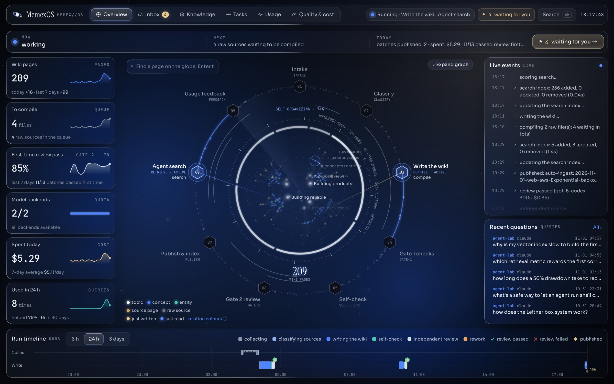
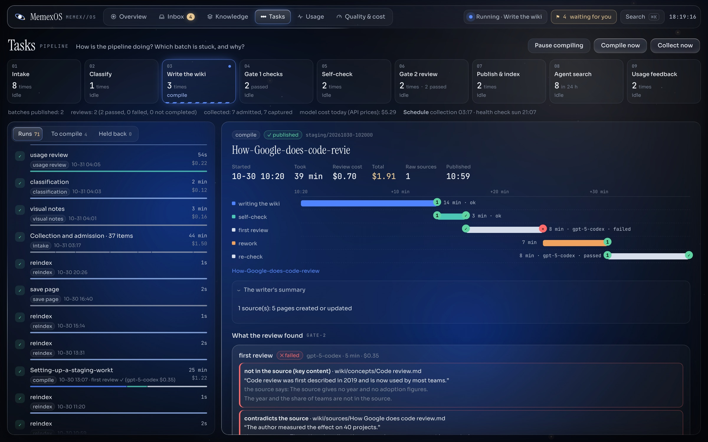
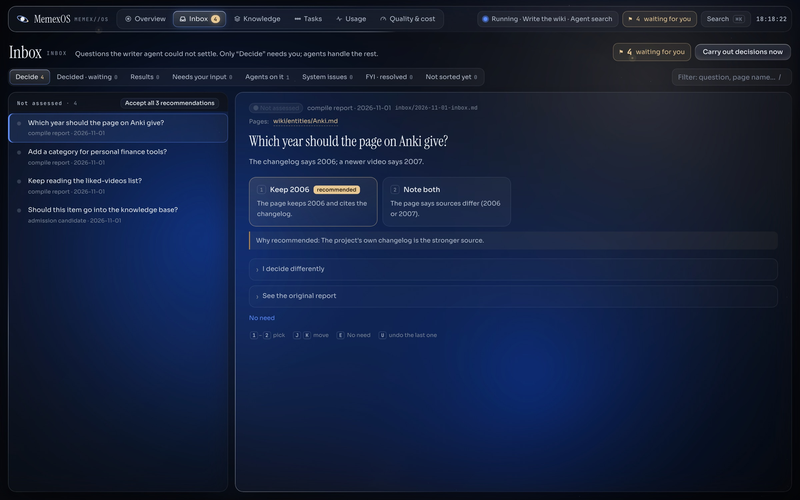
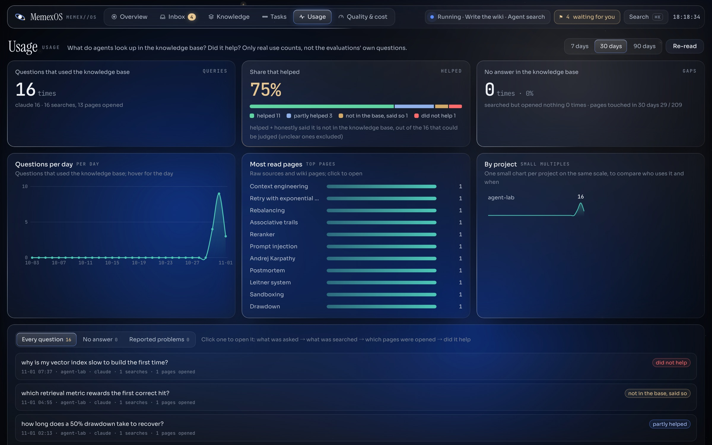
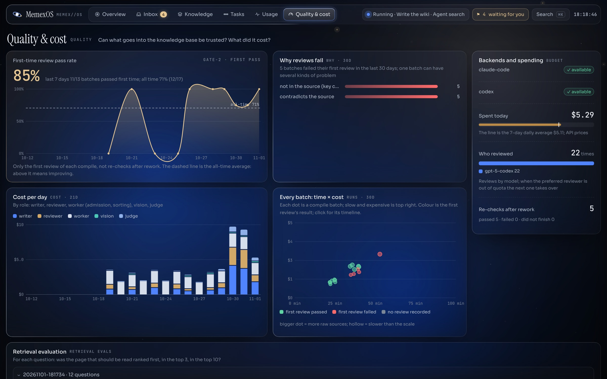

# MemexOS

**A memory OS for you and your agents.** MemexOS learns on its own from what you read, watch, save and discuss with
your AI agents, and turns it into a reviewed, linked wiki that any agent can search, so nothing you or your agents
learn is lost when a conversation ends.

[中文说明](README.zh-CN.md)



<sub>Screenshots show generated demo data (`tools/make_demo.py`), not anyone's real knowledge base.</sub>

## What it does

- **Learns on its own, across platforms.** Every night it collects what you saved: YouTube likes, watch-later and
  playlists, Bilibili favorites, X bookmarks and likes, RSS feeds, and links you send it. An admission agent decides
  what is worth keeping; videos without subtitles are transcribed on your machine.
- **Remembers across conversations.** It reads your Claude Code and Codex sessions and keeps what lasts (decisions,
  conclusions, measured results, mistakes not to repeat), so the next session, in any agent, can look them up.
- **Evolves itself.** It watches how agents use the knowledge (what they searched for, opened, cited, and whether it
  helped), turns wrong or missing answers into corrections, lints itself weekly, proposes new categories as your
  interests shift, and measures its own retrieval quality with a question bank it maintains.
- **Publishes nothing unreviewed.** Each compile happens in a staging copy and passes program checks, a self-check and an
  independent review by a second model that compares every sentence with its source. Failures go back for rework;
  every change is a git commit you can roll back.
- **Works with any agent and any model.** Agents use one command line (`memex search`, `memex get`). The writing runs on
  Claude Code, Codex, the Anthropic API, any OpenAI-compatible API, or a local model (Ollama, LM Studio, vLLM), mixed
  per role.
- **Asks you only to decide.** What agents cannot settle lands in an inbox as a question with options and a
  recommendation; the rest they research, check and fix themselves.
- **Shows you everything.** A local console shows the knowledge, every pipeline step as it runs, the inbox, how agents
  use the knowledge, review quality and spending.

| | |
|---|---|
|  |  |
| **Every run, step by step.** The review flagged two sentences; the writer fixed them; the re-check passed. | **You decide, agents do the rest.** |
|  |  |
| **Does the knowledge help?** Measured from real agent sessions. | **Can it be trusted, and what does it cost?** |

## Where the idea comes from

MemexOS starts from Andrej Karpathy's [LLM Wiki](https://gist.github.com/karpathy/442a6bf555914893e9891c11519de94f)
idea: instead of retrieving raw documents for every question, a language model reads each source once, *compiles* it
into a persistent wiki of linked markdown pages, keeps an index and a log, and maintains the wiki with three operations
(ingest, query, lint). Raw sources stay unchanged; the model owns the wiki; a schema file (`AGENTS.md`) tells it how.
In the gist's words, "the wiki is a persistent, compounding artifact": people abandon wikis because the bookkeeping
grows faster than the value, and bookkeeping is exactly what a model does not get tired of.

The name comes from Vannevar Bush's 1945 *memex*, a desk that would store and link everything its owner read.

What MemexOS adds is our own design for running that idea unattended, for months, without the wiki drifting from its
sources:

- **Trust before scale**: staging copies, two gates and an independent reviewer from a different model family;
  wording that follows the evidence ("according to …", "the author thinks …").
- **Input without effort**: collectors for the places you already save things, plus your own agent sessions, with an
  admission step so the wiki grows with signal, not noise.
- **A feedback loop**: agents' real use is measured and fed back into fixes; retrieval is evaluated against a
  question bank; the system's own problems go to an inbox.
- **Operations you can see**: every command writes a structured event log; the console, `memex status` and the
  evaluations are views over it.

## Install

You need macOS or Linux (on Windows, use WSL), git and curl. The installer sets up everything else, asking first:

```sh
curl -fsSL https://raw.githubusercontent.com/OWNER/memexos/main/install.sh | sh
```

It installs, in this order:

1. **MemexOS** itself, with [uv](https://docs.astral.sh/uv) (which brings its own Python).
2. **Node.js 22+ and [qmd](https://github.com/tobi/qmd)**, the local search engine (vector search and reranking, all on
   your machine), then qmd's models, about 2.2 GB. Without qmd, search still works with the built-in full-text index.
3. Optional: **yt-dlp, ffmpeg, whisper.cpp** and a speech model (for videos without subtitles) and **poppler** (PDFs).
4. A model backend if you have none: it can install the Claude Code or Codex command line for you to log in to.
5. `memex setup`: a few questions, then your knowledge base is created (with sample content if you like).

Prefer to have your agent do it? Give Claude Code or Codex the prompt in [docs/install-prompt.md](docs/install-prompt.md).
By hand: `uv tool install --with anthropic git+https://github.com/OWNER/memexos`, `npm install -g @tobilu/qmd`,
then `memex setup`. `memex doctor` checks everything at any time and says how to fix what is missing.

## Quick start

```sh
memex setup                            # or: memex init --sample   (a knowledge base in ~/memex)
memex search "how often should I review flashcards"
memex get "Spaced repetition"
memex console                          # http://127.0.0.1:8765
```

Add a source and compile it (this calls your models):

```sh
memex add-url https://example.com/some-article
memex ingest                           # write, check, review, publish
memex status
```

Run unattended:

```sh
memex schedule install                 # nightly collection, hourly compiling, reindexing, the console
```

## Give your agents the memory

Add a few lines to your agent's global instructions (`~/.claude/CLAUDE.md`, `~/.codex/AGENTS.md`, …):

```md
## Knowledge base
I keep a personal knowledge base. When a question touches something I have read, done or decided, run
`memex help` once and follow it: search with `memex search`, say which pages you used, and say so when the
knowledge base has nothing.
```

## Models

Work is split into roles, and each role tries a list of backends in order; when one runs out of quota the next takes
over. `memex setup` detects what you have and proposes a split; `memex doctor` shows it.

| Role | Does | Typical choice |
|---|---|---|
| writer | compiles and repairs the wiki | Claude Code, with its strongest model |
| reviewer | checks every sentence against its source | Codex, so a different model family reviews |
| worker | admission, sorting, inbox triage, usage review | Claude Code |
| vision | notes from video frames | Codex or Claude Code |
| judge | many small yes/no questions (self-check, reranking) | a small model, or Jev |

Backends:

- **Claude Code** and **Codex** command lines, using whatever they are logged in with (a subscription or an API key).
  Nothing to configure.
- **Anthropic API**: `memex secret set ANTHROPIC_API_KEY` (stored in the system keychain, never in a file).
- **Any OpenAI-compatible API**, hosted or local, under any name:

  ```toml
  # ~/.config/memexos/config.toml
  [backends.local]
  type = "openai"
  base_url = "http://127.0.0.1:11434/v1"     # Ollama; or LM Studio, vLLM, OpenAI, DeepSeek, Gemini, OpenRouter…
  model = "qwen3:14b"
  api_key_env = ""                           # local servers need no key; hosted ones: the variable that holds it

  [models]
  worker = ["local", "claude-code"]
  ```

  MemexOS runs the agent loop itself with sandboxed file tools, so any model with tool calling works. Small local
  models are fine for the worker and judge roles; writing and reviewing need a strong model.
- **Jev** for the judge role (optional, hosted, returns calibrated probabilities): `memex secret set JEV_API_KEY`, then
  `[judge] backend = "jev"`. It sends the sentences being judged to that service.

## What it costs

MemexOS itself is free. The model calls are what cost money, and only if you pay per call:

- With **Claude Code or Codex logged in to a subscription**, the work counts against your plan's usage limits and there is
  no separate bill. The console still shows what the same work would cost at API list prices, so you can see where
  the effort goes.
- With **API keys**, you pay per token. Compiling one long article with Opus as the writer comes to a few dollars at list
  prices (writing, the self-check and the review together); short pages cost less, and a nightly run costs what it
  collected. Set a cheaper `model` in `[backends.claude-code]` (or another backend for the writer role) to pay less.
- **Local models** cost nothing per call but are slower, and weaker as writers and reviewers.
- Search, the console, scheduling, transcription and the retrieval evaluation (L1) run locally and cost nothing.

The Quality & cost page shows spending per day and per role; `memex pause` stops compiling at any time.

## Scheduling

`memex schedule install` installs per-user jobs (launchd on macOS, systemd user units on Linux, cron elsewhere):
collection and the nightly chain at 03:17, compiling every hour, reindexing every 15 minutes, a weekly lint, and the
console. Jobs record the PATH they need and take locks so only one writes at a time. `memex schedule list` shows
them; `memex schedule remove` takes them out. Times and steps are in `[schedule]`.

## Commands

| | |
|---|---|
| Read | `search`, `get`, `catalog`, `help` |
| Add | `add-url`, `add-video`, `feedback` |
| Compile | `ingest`, `fix`, `correct`, `lint`, `pause`, `resume` |
| Collect | `intake`, `sessions`, `cookies` (plugins) |
| Decide | `inbox`, `console` |
| Watch | `status`, `usage`, `eval` |
| Set up | `setup`, `init`, `doctor`, `config`, `secret`, `schedule` |

## Configuration

Settings are layered: built-in defaults < the knowledge base's `.memex/config.toml` < `~/.config/memexos/config.toml`
< environment variables (`MEMEX_<SECTION>__<KEY>`). Every option is documented in
[`default_config.toml`](src/memexos/default_config.toml). Keys come from environment variables or the system keychain.
The interface, rules, prompts and logs come in English and Chinese (`memex init --lang zh`).

## What leaves your computer

- Text sent to the model backends you configure, as those tools always do.
- Optional services, only when you turn them on: a reader service for hard-to-fetch pages, the Jev judge.
- Nothing else. The console listens on 127.0.0.1 only. Collectors that need your logins (X, Bilibili, YouTube) are
  plugins, off until you enable them.

## Documentation

- [Architecture](docs/architecture.md): the knowledge base, the pipeline, the two gates, models, the event log, scheduling
- [Evaluations](docs/evals.md): retrieval quality and review calibration
- [Console](docs/console.md): where its data comes from, safety, design
- [Install prompt](docs/install-prompt.md): let an agent install and set it up

## Status

Early (0.1.0.dev0): interfaces may still change.

## Acknowledgements

Andrej Karpathy's LLM Wiki for the idea; [qmd](https://github.com/tobi/qmd) for local search;
[whisper.cpp](https://github.com/ggml-org/whisper.cpp) and [yt-dlp](https://github.com/yt-dlp/yt-dlp) for video.

## License

MIT. The console's bundled fonts are under the SIL Open Font License 1.1 (`src/memexos/console/static/fonts/OFL.txt`).
