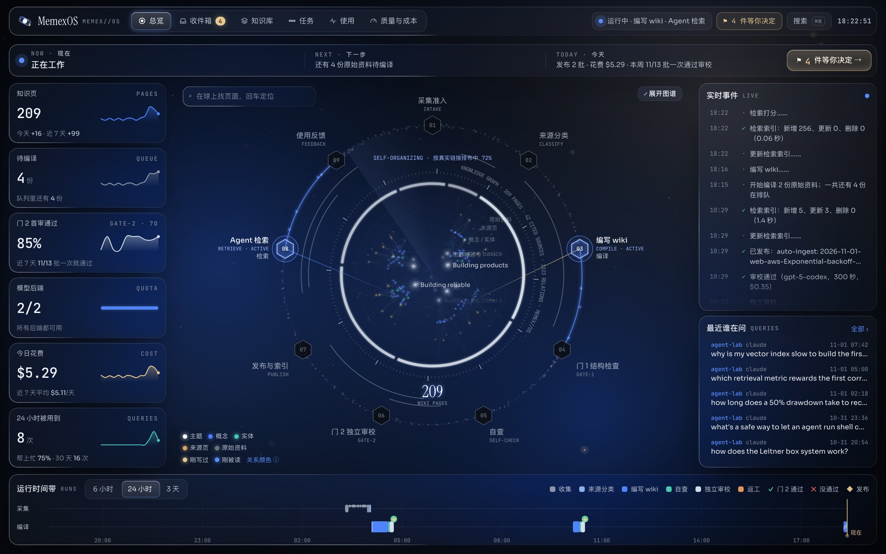
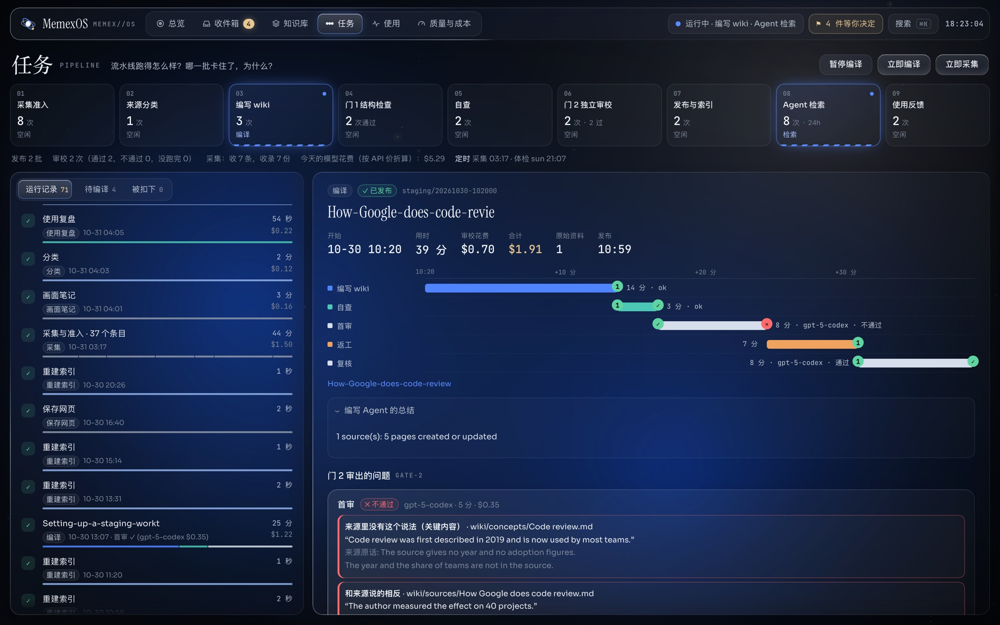
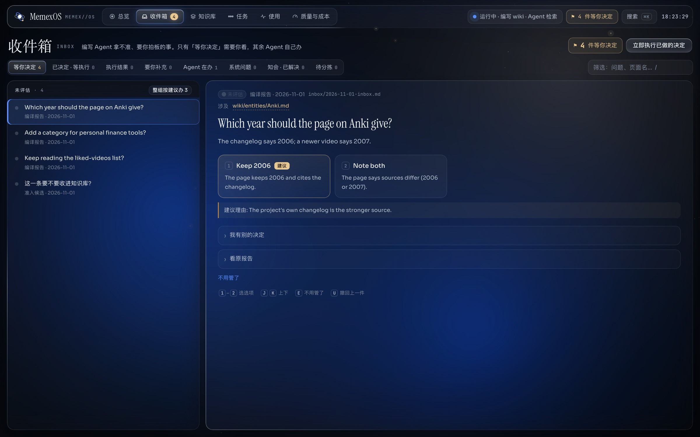
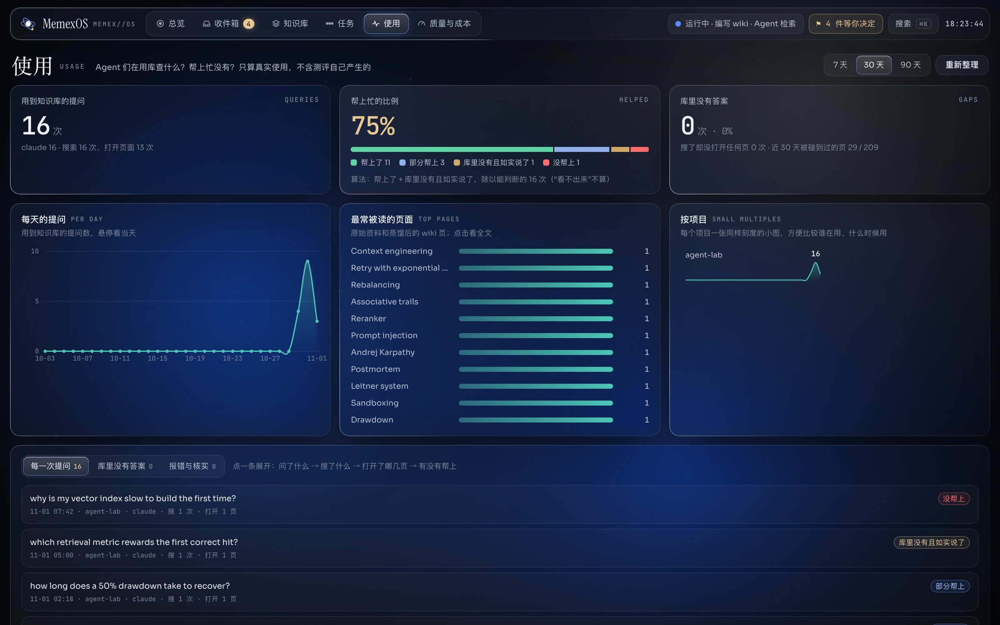
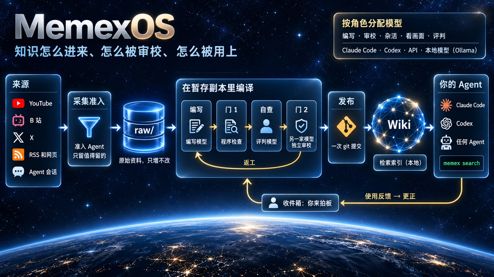
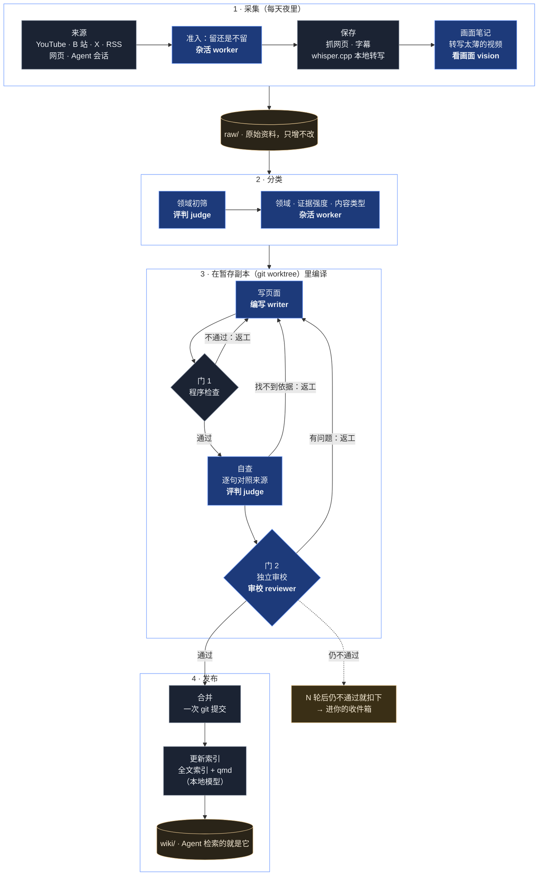
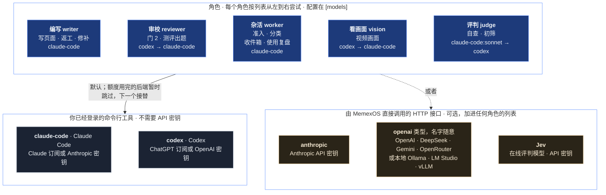

<div align="center">


# 给你和你的 Agent 用的记忆系统

**你读过、看过、收藏过、和 AI Agent 讨论过的东西，变成一个经过审校、互相链接、任何 Agent 都能检索的 wiki。
你和 Agent 学到的东西，不会因为一次对话结束就丢掉。**

[](https://github.com/liushengyu/memexos/actions/workflows/ci.yml)
[](LICENSE)
[](pyproject.toml)
[](#让你的-agent-用上这份记忆)
[](https://github.com/liushengyu/memexos/stargazers)

[安装](#安装) · [它是怎么工作的](#它是怎么工作的) · [模型怎么配](#模型怎么配) · [架构](docs/architecture.md) · [参与贡献](CONTRIBUTING.md) · [English](README.md)

</div>

## 从一个想法到一套系统

MemexOS 的起点是 Andrej Karpathy 提出的 [LLM Wiki](https://gist.github.com/karpathy/442a6bf555914893e9891c11519de94f)：
不要每次提问都回到原始文档里重新检索，而是让语言模型把每份来源读一遍，**编译**成一个长期保存、互相链接的 markdown
wiki，配一份目录（index）和一份日志（log），并用三种操作维护它：收录（ingest）、查询（query）、体检（lint）。原文的
说法是，wiki 是“一个持续积累、越用越值钱的成果”。人之所以放弃自己的 wiki，是因为记账的工作量比收获涨得快，而记账
恰恰是模型不会厌烦的事。

我们接过这个想法，追问一个问题：要让它替一个人和他用的所有 Agent 自己跑上几个月，而且内容不和来源越走越远，
还需要什么？MemexOS 就是我们的回答：

| LLM Wiki 的想法 | MemexOS 在它之上做了什么 |
|---|---|
| 原始来源保持不变 | `raw/` 只增不改；每个页面都列出它依据的来源；措辞跟着证据强度走 |
| 由模型来写、来维护 wiki | 编写 Agent 在暂存副本里编译；程序检查、自查、另一家模型的独立审校，挡在草稿和 wiki 之间 |
| 由人挑选来源 | 采集器每晚去你本来就会收藏东西的地方收（YouTube、B 站、X、RSS、链接），再加上你和 Agent 一起得出的结论；准入 Agent 只留值得留的 |
| 收录、查询、体检 | `memex ingest`；任何 Agent 都能用的 `memex search`、`memex get`；每周体检；再加上根据 Agent 实际使用情况做的更正 |
| 一份规则文件指导模型 | `AGENTS.md` 规则、随你兴趣生长的分类、只留给你拍板的收件箱、每一步都看得见的控制台 |

名字取自 Vannevar Bush 1945 年设想的 *memex*：一张能存下并链接主人读过的一切的书桌。



<sub>截图用的是生成的演示数据（`tools/make_demo.py`），不是任何人的真实知识库。</sub>

## 它能做什么

- **自己学习，横跨各个平台。** 每天夜里，它去收你收藏过的东西：YouTube 的赞过、稍后观看和播放列表，B 站收藏夹，
  X 的书签和点赞，RSS 订阅，以及你随手发给它的链接。准入 Agent 判断哪些值得留下；没有字幕的视频在你自己的电脑上
  转写成文字。
- **跨对话的记忆。** 它读你和 Claude Code、Codex 的会话记录，把值得长期保留的内容（做过的决定、得出的结论、实测数据、
  踩过的坑）存下来。下一次会话，不管用哪个 Agent，都能查到。
- **自我进化。** 它观察 Agent 怎么用这些知识（查了什么、打开了哪页、引用了什么、最后有没有帮上忙），把答错或答不上
  的地方变成更正；每周自查一遍；你的兴趣变了，它会提议新的分类；它还维护一套问题题库，定期测自己的检索准不准。
- **没审过的内容不发布。** 每次编译都在一份暂存副本里进行：先过程序检查，再自查，最后由另一个模型逐句对照原始来源
  独立审校。不通过就退回去返工；每一处改动都是一个可以回滚的 git 提交。
- **任何 Agent、任何模型都能用。** Agent 只需要一套命令行（`memex search`、`memex get`）。编写和审校可以用
  Claude Code、Codex、Anthropic API、任何兼容 OpenAI 接口的服务，或者本地模型（Ollama、LM Studio、vLLM），
  按角色混着用。
- **你只做决定。** Agent 定不下来的事进收件箱，每件都写成一个问题，附带选项和推荐；其余的查资料、核实、更正由 Agent
  自己办。
- **什么都看得见。** 本机控制台展示知识的全貌、流水线每一步的实时进度、收件箱、Agent 怎么用知识、审校质量和花费。

| | |
|---|---|
|  |  |
| **每次运行、每一步都看得到。** 首审指出两句话没有依据，编写 Agent 改完，复核通过。 | **你来拍板，其余交给 Agent。** |
|  |  |
| **知识到底有没有用？** 从 Agent 的真实会话里统计。 | **能不能信、花了多少钱？** |

## 它是怎么工作的



凡是需要判断的步骤，都交给某个模型**角色**来做；其余步骤都是程序。下面是一份资料走过的完整路径，每一步用的角色用粗体
标出（每个角色具体用哪个模型由你决定，见[模型怎么配](#模型怎么配)）：



不过两道检查，任何内容都进不了 `wiki/`。门 1 是程序，不是模型；门 2 用的是和编写模型不同的另一家模型，这样编写模型
自己看不出的错，不会再被同样的盲点放过去。

## 安装

需要 macOS 或 Linux（Windows 请用 WSL）、git 和 curl。其余的由安装脚本装好，每一步都会先问你：

```sh
curl -fsSL https://raw.githubusercontent.com/liushengyu/memexos/main/install.sh | sh
```

它按这个顺序安装：

1. **MemexOS** 本体，用 [uv](https://docs.astral.sh/uv) 安装（uv 会自带合适的 Python）。
2. **Node.js 22 以上和 [qmd](https://github.com/tobi/qmd)**：qmd 是本地检索引擎（向量检索和重排都在你自己的电脑上
   运行），然后下载 qmd 用的模型，约 2.2 GB。没有 qmd 也能检索，用的是内置的全文索引。
3. 可选：**yt-dlp、ffmpeg、whisper.cpp** 和一个语音识别模型（给没有字幕的视频转写），以及 **poppler**（读 PDF）。
4. 如果你还没有任何模型，它可以帮你装好 Claude Code 或 Codex 的命令行，你登录一下就能用。
5. `memex setup`：问你几个问题，然后建好你的知识库（愿意的话带上示例内容）。

想让 Agent 替你装？把 [docs/install-prompt.md](docs/install-prompt.md) 里的提示词交给 Claude Code 或 Codex。
手动安装：`uv tool install --with anthropic git+https://github.com/liushengyu/memexos`、`npm install -g @tobilu/qmd`，
再运行 `memex setup`。任何时候都可以用 `memex doctor` 检查一遍，它会说清缺什么、怎么补。

## 快速开始

```sh
memex setup                            # 或：memex init --sample   （在 ~/memex 建库）
memex search "how often should I review flashcards"
memex get "Spaced repetition"
memex console                          # http://127.0.0.1:8765
```

加一份资料并编译（会调用你配置的模型）：

```sh
memex add-url https://example.com/some-article
memex ingest                           # 编写、检查、审校、发布
memex status
```

无人值守运行：

```sh
memex schedule install                 # 每晚采集、每小时编译、定时更新索引、控制台常驻
```

`memex init --lang zh` 或 `memex setup --lang zh` 让知识库的规则、提示词、日志和控制台都用中文。

## 让你的 Agent 用上这份记忆

在 Agent 的全局指令里加几行（例如 `~/.claude/CLAUDE.md`、`~/.codex/AGENTS.md`）：

```md
## 知识库
我有一个个人知识库。问题涉及我读过、做过或决定过的事情时，先运行一次 `memex help` 并照做：用 `memex search` 查，
说明用到了哪些页面，库里没有就直说。
```

## 模型怎么配

工作分成几个角色。每个角色有一串后端，按顺序用第一个可用的；某个后端额度用完，下一个自动接替一段时间。`memex setup`
会检测你装了什么并给出建议，`memex doctor` 随时显示当前分工。



**用 Codex，还是用 OpenAI 的 API 密钥？** 两条路都能用到 OpenAI 的模型，但走法不一样：

| | `codex` 后端 | `openai` 类型后端 |
|---|---|---|
| 谁在干活 | Codex 命令行自己当 Agent 干活 | MemexOS 通过 HTTP 调用 Chat Completions 接口，Agent 循环和受沙箱限制的文件工具由 MemexOS 自己跑 |
| 怎么登录 | 用 Codex 已经登录的账号：ChatGPT 订阅（不需要 API 密钥），或 OpenAI API 密钥 | API 密钥（`api_key_env`）；本地服务不需要 |
| 怎么计费 | 计入你的 ChatGPT 套餐额度，或按你的 API 用量 | 按 token 向服务商付费；本地模型不花钱 |
| 能用哪些模型 | Codex 提供的模型 | 任何提供这种接口的服务：OpenAI、DeepSeek、Gemini、OpenRouter、通义千问、Kimi……，或者你电脑上的 Ollama、LM Studio、vLLM |
| 什么时候用 | 你已经有 ChatGPT 或 Codex | 你手里有某家服务的 API 密钥，或者想用本地模型 |

Anthropic 那边同理：`claude-code` 后端用你 Claude Code 的登录（Claude 订阅就行），`anthropic` 后端用 API 密钥。

HTTP 类后端的配置：

- **Anthropic API**：`memex secret set ANTHROPIC_API_KEY`（密钥存进系统钥匙串，不写进任何文件）。
- **任何兼容 OpenAI 接口的服务**，在线的或本地的都行，名字随便起：

  ```toml
  # ~/.config/memexos/config.toml
  [backends.local]
  type = "openai"
  base_url = "http://127.0.0.1:11434/v1"     # Ollama；也可以是 LM Studio、vLLM、OpenAI、DeepSeek、Gemini、OpenRouter……
  model = "qwen3:14b"
  api_key_env = ""                           # 本地服务不需要密钥；在线服务写存放密钥的环境变量名

  [models]
  worker = ["local", "claude-code"]
  ```

  小的本地模型适合杂活和评判；编写和审校需要强模型。
- **Jev**，用于评判角色（可选，在线服务，返回校准过的概率）：`memex secret set JEV_API_KEY`，然后设
  `[judge] backend = "jev"`。启用后，被评判的句子会发给这个服务。

## 花费

MemexOS 本身免费，花钱的是模型调用，而且只有按次付费时才花钱：

- **Claude Code 或 Codex 用订阅账号登录**时，这些工作计入你订阅套餐的用量额度，不会另外收费。控制台仍然按 API 标价
  折算显示同样的工作值多少钱，方便你看清力气花在了哪里。
- **用 API 密钥**时按 token 计费。用 Opus 当编写模型编译一篇长文章，按标价算要几美元（编写、自查、审校加在一起）；
  短页面更便宜，每晚的花费取决于当天收进来多少东西。想省钱，可以在 `[backends.claude-code]` 里设一个便宜些的
  `model`，或者给编写角色换一个后端。
- **本地模型**每次调用不花钱，但更慢，当编写和审校时能力也更弱。
- 检索、控制台、定时任务、语音转写和检索测评（L1）都在本机运行，不花钱。

控制台的「质量与成本」页按天、按角色显示花费；随时可以用 `memex pause` 暂停编译。

## 定时任务

`memex schedule install` 安装当前用户的定时任务（macOS 用 launchd，Linux 用 systemd 用户单元，其他系统用 cron）：
每天 03:17 采集并跑夜间任务链，每小时编译，每 15 分钟更新索引，每周体检一次，控制台常驻。每个任务都记录了自己要用
的 PATH，并用锁保证同一时间只有一个任务在写。`memex schedule list` 查看，`memex schedule remove` 全部移除。时间和
步骤在 `[schedule]` 里改。

## 命令

| | |
|---|---|
| 读 | `search`、`get`、`catalog`、`help` |
| 加资料 | `add-url`、`add-video`、`feedback` |
| 编译 | `ingest`、`fix`、`correct`、`lint`、`pause`、`resume` |
| 采集 | `intake`、`sessions`、`cookies`（插件） |
| 做决定 | `inbox`、`console` |
| 观察 | `status`、`usage`、`eval` |
| 设置 | `setup`、`init`、`doctor`、`config`、`secret`、`schedule` |

## 配置

设置分层：内置默认值 < 知识库里的 `.memex/config.toml` < `~/.config/memexos/config.toml` < 环境变量
（`MEMEX_<分组>__<键>`）。每一项都在 [`default_config.toml`](src/memexos/default_config.toml) 里有说明。密钥只从
环境变量或系统钥匙串读取。界面、规则、提示词和日志都有英文和中文两套。

## 哪些东西会离开你的电脑

- 发给你配置的模型后端的文本，和这些工具平时的行为一样。
- 可选服务，只有你开启时才用：抓取难抓网页用的阅读服务、Jev 评判模型。
- 除此之外没有。控制台只监听 127.0.0.1。需要你登录状态的采集源（X、B 站、YouTube）是插件，默认关闭，你开启才用。

## 文档

- [架构](docs/architecture.md)：知识库的结构、流水线、两道检查、模型、事件记录、定时任务
- [测评](docs/evals.md)：检索质量和审校校准
- [控制台](docs/console.md)：数据从哪来、安全、设计
- [安装提示词](docs/install-prompt.md)：让 Agent 替你安装和设置
- [参与贡献](CONTRIBUTING.md)：改动怎么合入、开发环境、CI 查什么
- [安全策略](SECURITY.md)：怎么私下报告安全问题

（文档目前是英文。）

## 参与贡献

欢迎参与。`main` 分支受保护：包括维护者在内，任何改动都要走拉取请求（pull request），必须通过 CI（Linux 和 macOS
上的测试、代码检查、泄漏扫描、从零安装、检索测评）；外部贡献者的改动还要维护者审核通过。先看
[CONTRIBUTING.md](CONTRIBUTING.md)；安全问题请按 [SECURITY.md](SECURITY.md) 私下报告。

## 状态

早期版本（0.1.0.dev0）：接口还可能变。

## 致谢

Andrej Karpathy 的 LLM Wiki 提供了最初的思路；[qmd](https://github.com/tobi/qmd) 提供本地检索；
[whisper.cpp](https://github.com/ggml-org/whisper.cpp) 和 [yt-dlp](https://github.com/yt-dlp/yt-dlp) 用于视频。

## 许可证

MIT。控制台自带的字体使用 SIL Open Font License 1.1（见 `src/memexos/console/static/fonts/OFL.txt`）。
