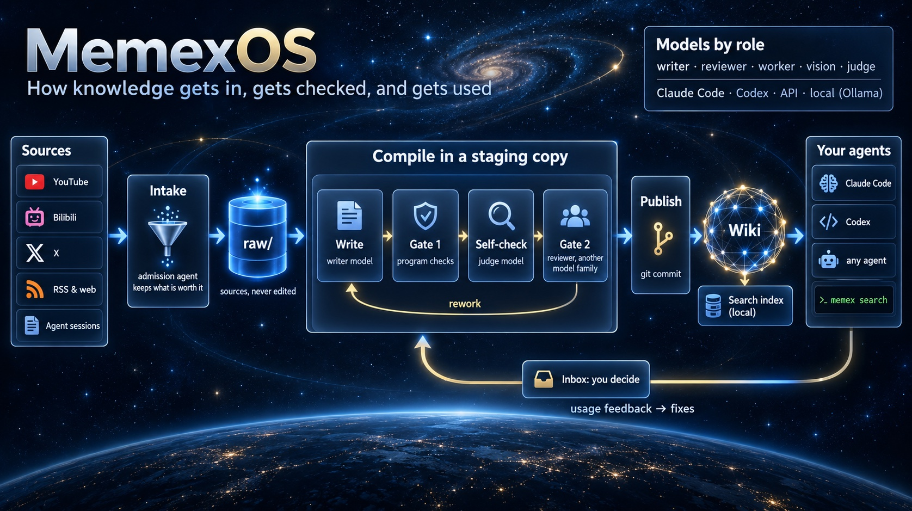
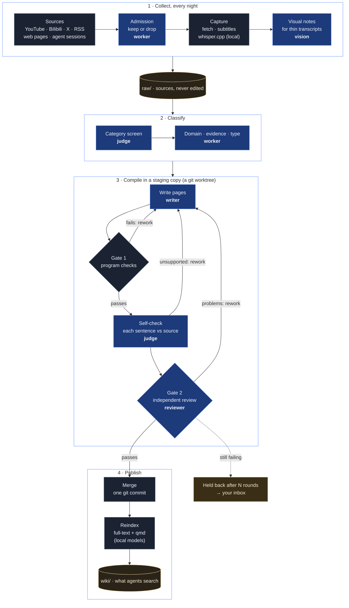
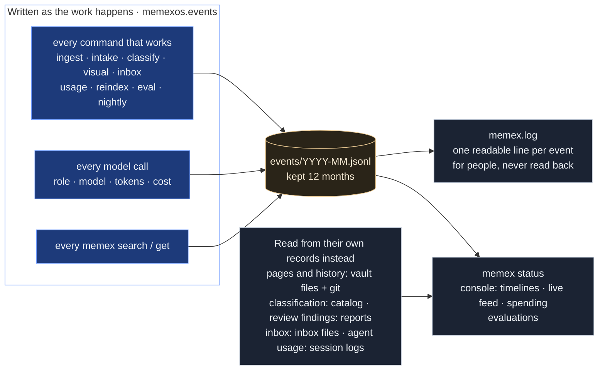
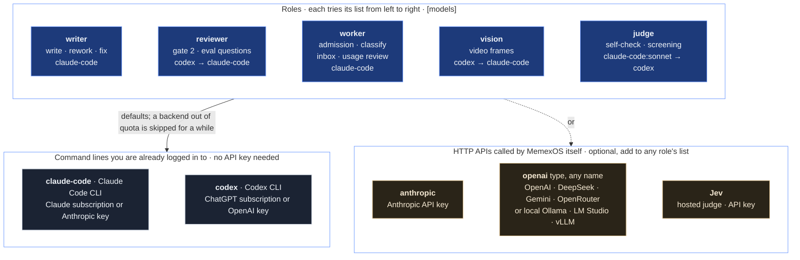

# Architecture

MemexOS keeps a knowledge base that agents write and agents read. Sources come in, a writer agent compiles them into
a wiki, two checks stand between a draft and publication, and any agent can search the result. A person decides what
matters and answers the questions the agents cannot settle; everything else runs unattended.



The write path, with the model **role** that does each step (the others are programs):



## The vault

A vault is a git repository with three layers:

| Path | What | Who writes it |
|---|---|---|
| `raw/` | sources exactly as captured (web pages, transcripts, session snapshots, documents); append only | capture and intake |
| `raw/feedback/` | corrections aimed at one sentence on one page | verification, the inbox, people |
| `wiki/{sources,concepts,entities,topics}/` | the compiled knowledge: one page per source, per concept, per entity, and topic overviews | the writer, through the gates |
| `index.md`, `log.md` | table of contents; append-only log | the writer |
| `inbox/` | questions and reports for the person | the writer and the pipeline |
| `AGENTS.md` (`CLAUDE.md`) | the rules every agent working in the vault follows | the person |
| `.memex/` | ledgers: what was compiled or held back, the source catalog, the taxonomy, the evaluation bank | the pipeline |

Everything that is not knowledge lives outside the vault, in per-vault state (`~/.local/state/memexos/<vault id>/`):
the event log, locks, review reports, run directories, usage data. The search index is a cache
(`~/.cache/memexos/search/`).

## Capture

- `memex add-url` fetches a page (directly, or through a reader service when configured), extracts the main text,
  refuses private network addresses, removes secrets it recognises, and writes a raw file with a uniform header.
- `memex add-video` prefers published subtitles and falls back to local speech-to-text; videos whose transcript is thin
  get visual notes from a vision model that reads sampled frames.
- `memex intake` (nightly) collects from enabled channels: your agent sessions (Claude Code, Codex), RSS feeds, and
  plugins such as bookmarks on X or favourites on Bilibili (off by default; they need your login cookies). An
  admission agent decides what is worth keeping, writes session snapshots for conclusions worth keeping, and leaves
  uncertain items as candidates in the inbox. Secrets are scanned for before anything lands in `raw/`.

Raw files are never edited. A newer version of a source is a new file.

## Classification

Every raw file gets a catalog entry (`.memex/catalog.jsonl`): domain (from the taxonomy in `.memex/taxonomy.md`),
content type, level, evidence strength, intended use, durability, a one-line scope note. The writer copies it into the
source page; readers use it to word claims ("according to a third-party report…"). When no category fits, the
classifier proposes a draft category instead of inventing one silently; drafts that gather enough material become
pending and wait for the person's decision in the inbox (`memex catalog drafts`).

## Compiling

`memex ingest` takes a small batch of pending raw files and:

1. opens a **staging worktree** on a new branch; the vault's own working tree is never edited mid-compile;
2. runs the **writer** (the `writer` role) with a policy that only allows writes to `wiki/`, `inbox/`, `index.md` and
   `log.md`; the vault's `AGENTS.md` tells it how to write pages;
3. **gate 1**: program checks on the diff: nothing outside the allowed places, `raw/` untouched, every new page has a
   Sources section pointing at existing raw files, is listed in the index, and the log got its entry. Failures go back
   to the writer for up to `gate1_fix_rounds` rounds;
4. **self-check**: a cheap judge model looks at each new sentence against the closest source passages and sends the
   writer the sentences it cannot find support for;
5. **gate 2**: another model (the `reviewer` role, ideally a different model family from the writer) reviews the
   diff against the sources sentence by sentence: supported, marked as inference, imprecise, unsupported, contradicted;
   silent overwrites of earlier conclusions; instructions inside sources that the writer obeyed; key points of the
   source that the wiki left out. The reviewer only gives verdicts; **whether the batch passes is computed by the
   program** from them. A failing review goes back to the writer with the problems, up to `gate2_fix_rounds` rounds;
6. **publish**: merge into the main branch and reindex. A batch that still fails is **held**: the branch is kept for a
   person to look at, the raw files are not retried automatically, and the inbox says why.

If the reviewer cannot run (quota, network), the batch is discarded and compiling pauses for a while: nothing
unreviewed is ever published. Minor problems in a passing review are recorded and repaired later by `memex fix`.

`memex lint` (weekly) reorganizes and repairs the wiki as a whole under gate 1. `memex correct` applies feedback from
`raw/feedback/` to exactly the sentences it targets, then reviews the change.

## Reading

`memex search` is built for agents: a built-in SQLite FTS5 index (works in read-only sandboxes, handles CJK), optional
vector search through [qmd](https://github.com/tobi/qmd), reciprocal-rank fusion and an optional reranker. Results
show each hit's kind, its classification and, for raw files, the wiki page compiled from them. `memex get` prints a
page, `memex catalog` filters sources by domain and evidence, and `memex help` gives agents one screen of rules for
using the knowledge base (cite pages, copy numbers exactly, word claims by evidence strength, say "not in the base").

## The loop back

- **Usage**: `memex usage` reads agent session logs to see what agents searched and opened and whether it helped
  (judged by a model afterwards); questions the base could not answer are candidates for new sources.
- **Feedback**: agents report wrong or outdated pages with `memex feedback`; a model verifies each report against the
  sources, and confirmed problems become fix jobs that go through review like any other change.
- **Inbox**: compile reports, held batches, admission candidates and category proposals are split into items,
  sorted by a model into "needs the person", "an agent can do it", "system problem" and "for information", and
  ranked by impact. The person decides in the console; the nightly run carries the decisions out (research on the web,
  read-only checks on this machine, corrections), again through the gates.
- **Evaluations**: `memex eval retrieval` measures whether the right pages are found and used; `memex eval gate2`
  checks the review against planted errors (see `docs/evals.md`).

## Running unattended

`memex schedule install` installs per-user jobs (launchd on macOS, systemd user units on Linux, cron elsewhere):
reindex every 15 minutes, compile hourly, the nightly chain (collect, visual notes, classify, catalog sync, question
coverage, usage review, fix, inbox), a weekly lint, and the console. Jobs record the PATH they need, take locks so only
one job writes at a time, and yield to waiting jobs between batches. `memex pause` stops compiling after the current
batch.

`memex setup` offers to install the schedule at the end; `memex schedule list` shows what is installed and
`memex schedule remove` takes it all out again. Times and the nightly chain are in `[schedule]`.

## The event log

Every command that does work records what it does, as it does it, in a structured event log. Nothing is parsed out
of human-readable logs afterwards: the code that does the work writes the event at the moment it happens, through one
module (`memexos.events`). `memex status`, the console's activity feed, run timelines and spending are all built from
these events.



Where: `<state>/events/YYYY-MM.jsonl`, one JSON object per line, one file per month. Months older than
`[state] keep_events_months` (12) are deleted. A plain-text mirror, `<state>/memex.log`, has one readable line per
event in your language (rendered from the language pack); it is for people and is never read back.

```json
{"ts": "2026-11-01T12:09:59+0800", "run": "add-url-20261101-120958-6f1b", "job": "add-url",
 "type": "step.end", "data": {"name": "capture", "seconds": 1.2}}
```

| Field | Meaning |
|---|---|
| `run` | one invocation of a command (`memex ingest`, the nightly chain, an evaluation…); nested commands carry their parent's run as `parent` |
| `job` | the kind of work (ingest, intake, classify, eval…); the console colours and groups by it |
| `type` | what happened; the table below |
| `data` | the details, different per type |

| Written by | Event types |
|---|---|
| every command run (`events.run`) | `run.start`, `run.end` (with result) |
| every stage of work (`events.step`) | `step.start`, `step.end` with duration and result: collect, admit, capture, visual, classify, write, rework, selfcheck, gate2, index, embed, triage, research, investigate, usage, verify, eval_* |
| every model call (`backends`, the Jev judge) | `model.call`: role, backend, model, seconds, tokens, cost in USD (API list price; for subscription logins this is what the same work would cost through the API) |
| compiling | `ingest.start`, `stage.open`, `writer.done`, `writer.retry`, `writer.denials`, `gate1.result`, `selfcheck.result`, `gate2.result`, `gate2.unavailable`, `publish`, `hold`, `stage.discard`, `ingest.failed`, `ingest.waiting`, `fix.start`, `correct.start`, `correct.done` |
| collecting | `intake.run`, `intake.batch`, `intake.channel_failed`, `intake.quota`, `intake.done`, `capture.done`, `capture.failed`, `capture.video`, `capture.redacted`, `visual.*` |
| sorting | `classify.batch`, `classify.failed`, `catalog.sync`, `catalog.check` |
| reading | `search`, `read` (every `memex search` / `memex get`, by agents or by you) |
| the loop back | `feedback` (an agent reported a wrong page), `inbox.record_blocked` |
| scheduling | `nightly.step`, `nightly.step_failed`, `nightly.done`, `index.update`, `index.qmd`, `eval.progress` |

To record something new, use the same three calls the pipeline uses: `events.run(state, job)` around a command,
`events.step(state, name)` around a stage (fill the yielded dict with results), and `events.emit(state, type, **data)`
for a single fact. Add a line for the new type to `[event]` in each language pack so it reads well in the log and the
console; a type without one still shows, as its raw name.

Not everything the console shows is an event. Some things already have a better record of their own, and the console
reads them directly:

| What | Read from | Why not events |
|---|---|---|
| pages, links, growth, page history | the vault's files and its git history | git already records every change, with the full text |
| classification | `.memex/catalog.jsonl`, the taxonomy files | they are the source of truth that classification maintains |
| review findings | `<state>/gate2/<batch>/review.json` | the full report; `gate2.result` carries only the verdict and counts |
| inbox | `inbox/*.md` and the decision log | they are what you read and answer |
| how agents used the knowledge | your agents' own session logs (Claude Code, Codex), extracted into `<state>/usage/` | only the session shows what the agent did with the results; the `search`/`read` events show only the calls |
| evaluation scores | `<state>/evals/…/summary.json` | the full report of each evaluation run |

## Models

Work is assigned to roles, and each role lists backends in order of preference (`[models]`):



Every model call in the system, by step:

| Step | Role | Mode | Default list |
|---|---|---|---|
| admission (intake) | worker | agent: reads the candidates, may open pages | claude-code |
| visual notes | vision | structured: sampled video frames in, notes out | codex → claude-code |
| category screen | judge | many small multiple-choice questions | claude-code:sonnet → codex (or Jev) |
| classification | worker | structured | claude-code |
| write, rework, fix, lint, apply inbox decisions | writer | agent in the staging worktree, write access only to `wiki/`, `inbox/`, `index.md`, `log.md` | claude-code |
| self-check | judge | one yes/no question per new sentence | claude-code:sonnet → codex (or Jev) |
| gate 2 | reviewer | structured, read-only | codex → claude-code |
| inbox triage, dedupe | worker | structured | claude-code |
| inbox impact ranking | judge | multiple choice | claude-code:sonnet → codex (or Jev) |
| web research, local checks for inbox items | worker | agent: web on, or read-only on named folders | claude-code |
| usage review, verifying reported problems | worker | structured | claude-code |
| evaluation questions and judging | `[evals] role` (reviewer) | structured | codex → claude-code |
| reranking search results | none by default (qmd's local reranker); judge if `search.rerank = "llm"` | | |

Programs, no model: collecting, capture (fetching, subtitles, local whisper.cpp transcription), gate 1, publishing,
indexing (SQLite full-text and qmd's local embedding and reranking models), scheduling, the console.

| Role | Does | Default |
|---|---|---|
| writer | compiles and repairs the wiki | Claude Code |
| reviewer | gate 2, evaluation questions | Codex, then Claude Code |
| worker | admission, classification, inbox sorting, usage judging | Claude Code |
| vision | visual notes from video frames | Codex, then Claude Code |
| judge | many small yes/no judgments (self-check, reranking, impact) | Claude Code with a small model |

Backends, any mix of them:

| Type | What it is | Configure |
|---|---|---|
| `claude-code` | the Claude Code command line, with whatever account it is logged in with (subscription or API key) | nothing; `[backends.claude-code]` picks models per effort |
| `codex` | the Codex command line, likewise | nothing; `[backends.codex]` |
| `anthropic` | the Anthropic API through the official SDK (`pip install "memexos[anthropic]"`) | `ANTHROPIC_API_KEY` |
| `openai` | any OpenAI-compatible Chat Completions API: OpenAI, Gemini, DeepSeek, Qwen, Kimi, OpenRouter, or a model on your own machine (Ollama, LM Studio, vLLM) | `base_url`, `model`, `api_key_env` in `[backends.<name>]` |

Several `openai`-type endpoints can be defined side by side under different names, for example a hosted one for
writing and a local one for the many small worker calls:

```toml
[backends.local]
type = "openai"
base_url = "http://127.0.0.1:11434/v1"
model = "qwen3:14b"
api_key_env = ""          # local servers need no key
proxy = "direct"

[models]
worker = ["local", "claude-code"]
```

For the `openai` type MemexOS runs the agent loop itself, with sandboxed file tools enforced by its own process, so
any model that supports tool calling can compile; answers are checked against the expected JSON schema and
reformatted in one extra turn if needed. Smaller local models are fine for the worker and judge roles; writing and
reviewing need a strong model.

A backend that runs out of quota is skipped for a while and the next one takes over. Agent runs get an explicit
policy: writable paths, readable paths, allowed command prefixes, network on or off, paths never to read. Codex runs
do not load your personal Codex configuration; Claude Code runs load no MCP servers and no user settings.

The judge (`[judge] backend`) answers many small yes/no and multiple-choice questions: is this sentence supported by
the source, which category fits, is this search result relevant. `llm` (default) sends them in batches to the judge
role's backends. `jev` uses Jev, a hosted model that returns calibrated probabilities; it needs `JEV_API_KEY`
(`memex secret set JEV_API_KEY`, or `memex setup`) and sends the judged text to that service. `none` turns judging
off; every caller has a path that works without it.

`memex setup` detects which of these are installed and logged in, proposes roles, and writes the choices into your
config; `memex doctor` shows the result at any time.

## Configuration

Settings are layered: built-in defaults (`default_config.toml`, every option documented) < the vault's
`.memex/config.toml` < your `~/.config/memexos/config.toml` < environment variables (`MEMEX_<SECTION>__<KEY>`, plus
`MEMEX_VAULT`, `MEMEX_LANG`, `MEMEX_STATE_DIR`, `MEMEX_CACHE_DIR`). Secrets (API keys) come from environment variables
or the system keychain (`memex secret set`), never from files in the repository. Language packs (`locale/`,
`prompts/`, `templates/`, `help/`) exist for English and Chinese; a missing translation falls back to English.

## Extending

- **Backends**: subclass `memexos.backends.base.Backend` (`structured` and `agent`) and register it in
  `backends.REGISTRY`.
- **Collectors**: a plugin module (entry point group `memexos.plugins`) can add fetch commands, a capture handler for
  its URLs and an intake channel.
- **Judges and rerankers**: `judge.backend` (`llm`, `jev`, `none`) and `search.rerank` (`none`, `qmd`, `llm`, `jev`).
- **Search**: qmd is optional; without it the built-in full-text index is used everywhere.
